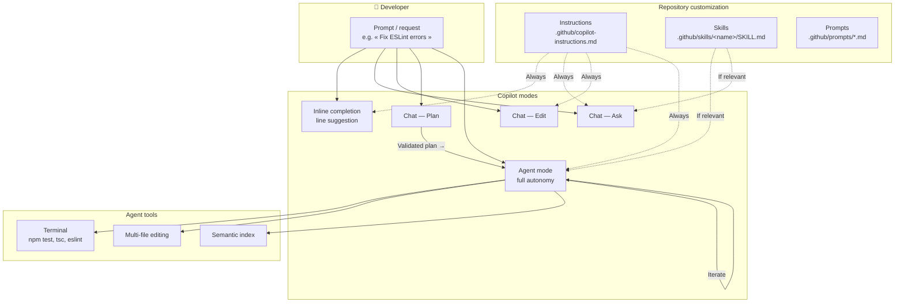

# Developing in TypeScript with GitHub Copilot

GitHub Copilot training for TypeScript development: from **inline completions** to **Agent mode**, through customization (**Instructions**, **Skills**).

| Module | Topic |
| ------ | ----- |
| 1 | Introduction |
| 2 | Inline completions |
| 3 | Chat and modes |
| 4 | Agent, Skills, Instructions + diagram |
| 5 | Path-specific, advanced skills, commit, review |
| 6 | Best practices |

---

## Module 1: Introduction to GitHub Copilot

### What is GitHub Copilot?

GitHub Copilot is an AI-powered programming assistant developed by GitHub in collaboration with OpenAI. It works as a **virtual pair programmer** integrated directly into the code editor.

**How it works:**

- Copilot analyzes the context of the code being written (open files, comments, variable names)
- It generates code suggestions in real time, directly in the editor
- The underlying model was trained on billions of lines of code from public GitHub repositories
- It is particularly effective with TypeScript thanks to the massive open source ecosystem (React, Node.js, NestJS, Deno, etc.)

**What Copilot is not:**

- It is not the TypeScript compiler (`tsc`) or ESLint
- It does not guarantee that generated code is correct or secure
- It does not replace understanding TypeScript and static typing

### The different versions — from completion to agent

GitHub Copilot offers several **levels of autonomy**. This course is structured around **Agent mode** and its customization (**Instructions**, **Skills**), while still covering **inline completions** for day-to-day writing.

| Version              | Autonomy level | Description                                    | Primary use case                         |
| -------------------- | -------------- | ---------------------------------------------- | --------------------------------------- |
| **Copilot (inline)** | Low            | Code suggestions directly in the editor        | Day-to-day completion, boilerplate      |
| **Copilot Chat**     | Medium         | Conversation (Ask, Edit, Plan)                 | Questions, explanations, refactoring    |
| **Agent mode**       | High           | Plans, edits multiple files, executes          | Multi-file tasks, debugging, migration  |
| **Copilot CLI**      | High           | Agent on the command line                      | Shell, tests, CI, scripts                 |

**Copilot inline** remains the entry point: as soon as you type code, suggestions appear in gray (`Tab` to accept). See **Module 2**.

**Copilot Chat** covers Ask, Edit, Plan, and Agent. See **Module 3**.

**Instructions, Skills, and Agent mode**: see **Modules 4 and 5**.

**Copilot CLI** (`gh copilot`) brings agentic logic outside the editor — useful for running tests (`npm test`), type-checking (`tsc --noEmit`), or formatting code.

> **Course thread:** master inline completions, then Chat, then customize the project with Instructions and Skills for Agent mode.

### Installation and configuration

**Prerequisites:**

- A GitHub account with an active Copilot subscription (Individual, Business, or Enterprise)
- Visual Studio Code installed
- Microsoft **TypeScript and JavaScript** extension (IntelliSense) + **ESLint** recommended

**Installation steps:**

1. Open VS Code
2. Go to Extensions (`Ctrl + Shift + X`)
3. Search for "GitHub Copilot" and install the extension
4. Also install "GitHub Copilot Chat"
5. Sign in to GitHub when VS Code prompts you
6. Verify the Copilot icon in the status bar (at the bottom)

**Verifying that it works:**
Create a `test.ts` file and start typing:

```typescript
// Function that prints Hello World
function greet(name: string): string {
```

If Copilot is working, a gray suggestion should appear to complete the function.

### Interface and usage statistics

To view Copilot usage statistics:

- Click the Copilot icon in the VS Code status bar
- Access the dashboard via GitHub: `Settings > Copilot > Usage`
- Available metrics: suggestion acceptance rate, lines of code generated, most-used languages

In enterprise settings (Copilot Business/Enterprise), administrators have access to a detailed dashboard showing usage percentage by team and by developer.

---

## Module 2: Inline completions and context

**Inline completions** are the most frequently used mode day to day. Once **Instructions** are configured (Module 4), they produce suggestions aligned with the project's TypeScript standards.

### Essential keyboard shortcuts

| Action                           | Shortcut (Windows/Linux) | Shortcut (Mac) |
| -------------------------------- | ------------------------- | --------------- |
| Accept suggestion                | `Tab`                     | `Tab`           |
| Reject suggestion                | `Escape`                  | `Escape`        |
| Next suggestion                  | `Alt + ]`                 | `Option + ]`    |
| Previous suggestion              | `Alt + [`                 | `Option + [`    |
| Accept next word                 | `Ctrl + →`                | `Cmd + →`       |
| Trigger manually                 | `Alt + \`                 | `Option + \`    |
| Open suggestions panel           | `Ctrl + Enter`            | `Ctrl + Enter`  |

The suggestions panel (`Ctrl + Enter`) opens a window with up to 10 alternative suggestions. Useful when the first suggestion is not a good fit.

### Triggering suggestions

#### Start typing a function signature

```typescript
function calculateFactorial(n: number): number
```

Copilot will propose the function body based on the explicit name and types.

#### Write a descriptive comment

```typescript
/** Bubble sort on an array of numbers, returns a sorted copy */
function bubbleSort(arr: number[]): number[]
```

The comment guides Copilot toward the expected algorithm.

#### Create a data structure

```typescript
interface Employee {
  name: string;
  age: number;
  salary: number;
}
```

Copilot can then suggest coherent functions (createEmployee, formatEmployee, etc.).

#### Name variables explicitly

```typescript
const maxRetryCount = 3;
let errorMessage: string | null = null;
const inputStream = createReadStream("data.csv");
```

Clear variable names help Copilot understand the intent of the code.

### Context matters

Copilot does not rely solely on the current line. It analyzes a **broader context**:

**Files open in the editor:**
If you have `utils.types.ts` open with interfaces, Copilot will use them to generate coherent implementations in `utils.ts`.

**Imports influence suggestions:**

```typescript
import { Router } from "express";     // Copilot suggests REST routes
import React, { useState } from "react"; // Copilot suggests components/hooks
import { z } from "zod";              // Copilot suggests validation schemas
```

**Surrounding code guides generation:**
If previous functions use a particular style (error handling, async patterns, immutability), Copilot will reproduce that pattern.

```typescript
// If your existing code does this:
const result = await fetch(url);
if (!result.ok) {
  throw new ApiError(result.status, await result.text());
}

// Copilot will reproduce this HTTP error-handling pattern
```

### The context window

The **context window** is the maximum amount of text — code, comments, chat history, project instructions — that the model can take into account **in a single request**.

**Concrete definition:**

- Everything Copilot "sees" before responding occupies this window: open files, selection, chat messages, `@workspace`, Copilot instructions, etc.
- This limit is measured in **tokens** (text fragments), not lines of code.
- Beyond the limit, the oldest or lowest-priority content is **truncated**.

**Why it matters:**

| Consequence                       | Explanation |
| --------------------------------- | ----------- |
| **Loss of context**               | A large file + chat history can make Copilot "forget" the beginning. |
| **Less coherent suggestions**     | If your conventions no longer fit in the window, Copilot falls back to generic patterns. |
| **Incomplete Agent responses**    | On a large repository, the agent must target the right files. |
| **Quality cost of the prompt**    | Relevant context is better than voluminous context. |

**Best practices for optimizing the window:**

- Keep open only **relevant** files (e.g. `utils.types.ts` + `utils.ts`, not the entire project).
- Ask **targeted** questions in chat rather than pasting thousands of lines.
- Use `#file:src/services/parser.ts` for a specific file rather than `#workspace` when the question is local.
- Break large refactors into steps (module by module).
- Centralize project rules in **Instructions** (see Module 4).

### The art of the comment-prompt

In TypeScript, JSDoc comments and typed signatures guide Copilot.

**Vague comment → imprecise result:**

```typescript
// sort the array
```

**Precise comment → targeted result:**

```typescript
/**
 * Insertion sort on an array of numbers in ascending order.
 * O(n²) worst-case complexity. Does not mutate the argument — returns a copy.
 */
function insertionSort(arr: number[]): number[]
```

### Basic principles

**Be specific and precise:**

```typescript
// ❌ Vague
// read a file

// ✅ Precise
/** Reads a text file line by line. Returns an array of lines. Throws if the file is not found. */
async function readLines(filePath: string): Promise<string[]>
```

**Provide context:**

```typescript
// This function is part of the Redis cache service
// Retrieves a key with TTL, returns null if expired or absent
async function getCached<T>(key: string): Promise<T | null>
```

**Break down complex problems:**

```typescript
// Step 1: Parse a CSV line into tokens
function parseCsvLine(line: string): string[];

// Step 2: Convert tokens into Employee
function tokenToEmployee(tokens: string[]): Employee;

// Step 3: Insert into the array with immutability
function insertEmployee(employees: Employee[], emp: Employee): Employee[];
```

**Iterate on suggestions:**
If the first suggestion is not a good fit, use `Alt + ]` to see alternatives, or rephrase the comment.

### Structure of a good prompt

An effective prompt follows the **What / How / Constraints** structure:

```typescript
/**
 * WHAT: Search for an element in a sorted array
 * HOW: Binary search
 * CONSTRAINTS:
 *   - Array sorted in ascending order
 *   - Returns the index or -1
 */
function binarySearch(arr: readonly number[], target: number): number
```

Another example:

```typescript
/**
 * WHAT: Deep clone of a typed binary tree
 * HOW: Recursive traversal with immutable spread
 * CONSTRAINTS:
 *   - Returns null if the root is null
 *   - Preserve generic typing TreeNode<T>
 */
function deepCopyTree<T>(root: TreeNode<T> | null): TreeNode<T> | null
```

### Iteration and refinement

**Partially accept a suggestion:**
Use `Ctrl + →` (accept word by word) when the beginning of the suggestion is good but the rest diverges.

**Edit and retry to refine:**

```typescript
// First attempt — basic bubble sort
// Sort an array

// Second attempt — more precise
/** Quicksort with median pivot, Lomuto partition, fallback to insertion sort if length < 10 */
function quicksort(arr: number[]): number[]
```

**Combine multiple suggestions:**
Accept a suggestion for the skeleton, then remove certain parts and ask again with a more specific comment.

---

## Module 3: Chat and interaction modes

### Chat modes — Ask, Edit, Plan, Agent

Copilot Chat offers several **modes** depending on the desired level of autonomy. They share the project's **Instructions**; only **Agent** and partially **Ask** leverage **Skills** (see Module 4).

| Mode       | Autonomy | Behavior                                      | TypeScript example                          |
| ---------- | --------- | ------------------------------------------------- | ------------------------------------------------- |
| **Ask**    | Low       | Responds, explains, does not modify files         | "Explain this useEffect hook and its dependencies"           |
| **Edit**   | Medium    | Modifies selected code or the active file         | "Add strict typing to this any parameter"     |
| **Plan**   | Medium    | Produces a detailed plan before acting            | "Plan to migrate this CommonJS module to ESM"  |
| **Agent**  | High      | Plans, edits, executes, iterates                  | "Fix all ESLint errors in src/"    |

**Ask** — understand code without modification:

- Select a block, ask a question: "Why does this Promise never resolve?"
- Instructions apply (e.g. response aligned with your JSDoc / TSDoc conventions)

**Edit** — localized changes:

- Select a function, request "/fix" or a targeted modification
- Faster than Agent for a one-off change

**Plan** — large tasks:

- Copilot produces a numbered plan; you validate before switching to Agent

**Agent** — core of the agentic approach (see Module 4):

- Terminal access, multi-file edits, semantic index
- Automatically activates relevant **Skills**

### Conversational interface

Open the Chat panel: `Ctrl + Shift + I` (or `Cmd + Shift + I` on Mac).

**Useful TypeScript question examples:**

- "Explain this React component and its lifecycle"
- "Why does TypeScript infer `never` here?"
- "How do I implement a typed Express middleware?"
- "Generate Vitest tests for this function"
- "Optimize this React render to avoid unnecessary re-renders"

**Get detailed explanations:**
Select a complex block of code, then ask in chat:
"Explain this code step by step, especially the async/await handling and types"

### Slash commands

| Command   | Action                                              |
| ---------- | --------------------------------------------------- |
| `/explain` | Explains the selected code                          |
| `/fix`     | Proposes a fix for the selected code                |
| `/tests`   | Generates tests for the selected code                 |
| `/doc`     | Generates documentation (JSDoc / TSDoc) |
| `/new`     | Creates a new file/project                          |
| `/clear`   | Clears chat history                                 |

**Example with `/doc`:**

```typescript
function addNode(list: LinkedList, data: unknown): number;
```

```typescript
/**
 * Adds a node at the head of the linked list.
 * @param list - Target list
 * @param data - Data to store
 * @returns The index of the created node, or -1 on error
 */
function addNode(list: LinkedList, data: unknown): number;
```

### Context selection

Highlight a block of code, then open chat → Copilot understands that the question is about that specific code.

### Semantic codebase indexing

**Semantic indexing** allows Copilot to **understand the meaning** of the project's code, not just match keywords.

**Principle:**

- The repository is analyzed into embeddings: functions, types, comments, relationships between files.
- A question such as "Where is validation handled?" or `@workspace find duplicate handlers` relies on this index.
- Relevant results are injected into the context window.

| Approach                          | Limitation |
| --------------------------------- | ------ |
| Open files + current line         | Only covers what you have in front of you |
| Symbol name search                | Misses implementations under a different name |
| **Semantic index**                | Finds code by **intent** ("Zod validation", "auth middleware", "API error handling") |

**Best practices:**

- Let indexing finish after a clone or a large pull.
- Formulate queries with **concepts** ("React hook", "CSV parsing", "repository pattern").
- Combine semantic index + `#file:src/services/parser.ts`.

### Agent mode in practice

**Agent mode** is where the **Skills** and **Instructions** configured in Module 4 are applied.

Copilot can:

- Run terminal commands (`npm test`, `tsc --noEmit`, `eslint`, `vitest`)
- Modify multiple files in sequence
- Iterate until a problem is resolved or a blocker is reported

```
Agent mode: "Fix all TypeScript and ESLint errors in src/"
→ Copilot activates the lint-and-typecheck skill (if present)
→ Applies Instructions (strict, no any)
→ Runs tsc and eslint, fixes files, reruns tests
```

**Agent best practices:**

- State a **measurable goal** ("0 tsc and eslint errors in src/")
- Let semantic indexing finish on large repositories
- Manually review the diff before committing

### Cloud mode (preview)

Cloud mode allows running Copilot tasks on GitHub infrastructure:

- Long-running background tasks
- No need to keep VS Code open
- Results via notification or PR
- Useful for large-scale refactors or migrations

---

## Module 4: Agentic architecture — Agent, Skills, Instructions

After inline completions (Module 2) and Chat (Module 3), this module details **agentic customization**: Instructions, Skills, and Agent mode.

### Overview

| Concept          | Role                                      | When it is active                          | Typical file                          |
| ---------------- | ----------------------------------------- | ------------------------------------------ | ---------------------------------------- |
| **Instructions** | Permanent project rules                   | **Always** (inline, chat, agent)           | `.github/copilot-instructions.md`        |
| **Skill**        | Specialized workflow, loaded on demand    | When the task matches the description      | `.github/skills/<name>/SKILL.md`          |
| **Agent**        | Autonomous mode that plans and executes   | On explicit request (Agent mode)           | Chat interface or Copilot CLI            |

**Instructions** define _how to code in this repository_. **Skills** teach _how to accomplish a repetitive task_. The **Agent** _orchestrates_ everything.

### What is an Agent?

A Copilot **agent** is an **autonomous** assistant capable of:

- **Planning** a task in multiple steps
- **Reading and modifying** multiple project files
- **Executing commands** in the terminal
- **Iterating** until a satisfactory result is reached

Unlike **inline completion** or **Ask** mode, the agent **acts** on the repository.

**Concrete TypeScript example:**

```
Agent mode: "Fix all strict TypeScript errors in this monorepo"
→ Runs tsc --noEmit on each package
→ Analyzes diagnostics (file:line)
→ Fixes types and imports
→ Reruns Vitest tests
```

### What is an Instruction?

**Instructions** are **permanent** guidelines injected into **every** interaction.

They answer: _"What are the rules of this TypeScript project?"_

| File                              | Scope                                              |
| ------------------------------------ | --------------------------------------------------- |
| `.github/copilot-instructions.md`    | Global — entire repository                          |
| `.github/instructions/*.md`          | Per path (applyTo: "src/**/*.ts")                   |
| User instructions (settings)         | All your projects                                   |

**Example for a TypeScript project:**

```markdown
# Instructions for this TypeScript project

- TypeScript strict (`strict: true`), forbid `any` except with `@reason` comment
- camelCase for variables/functions, PascalCase for types and React components
- Prefer `async/await` over chained Promises with `.then()`
- Document public API with JSDoc (@param, @returns)
- Error handling: typed error classes or Result<T, E>, no bare throw without context
- Mentally run `tsc --noEmit` before suggesting code
```

**When to use Instructions:**

- Naming and style conventions
- strict mode, React conventions, project ESLint rules
- Training guidelines (do not complete exercise TODOs)

> Keep Instructions **short and general**. For a detailed workflow, prefer a **Skill**.

### What is a Skill?

A **Skill** is a folder with `SKILL.md` and, optionally, scripts and references. Copilot **loads it when the task matches** the description.

**Structure:**

```
.github/skills/
└── lint-and-typecheck/
    ├── SKILL.md
    ├── scripts/
    │   └── run_checks.sh
    └── references/
        └── patterns.md
```

**Example `SKILL.md`:**

```markdown
---
name: lint-and-typecheck
description: Verifies strict typing and ESLint on a TypeScript project. Use when the user mentions tsc, ESLint, type error, lint, or strict mode.
---

## Workflow

1. Identify project scripts (`npm run lint`, `npm run typecheck`)
2. Run `tsc --noEmit` then `eslint src/`
3. For each error: locate file:line, fix types/imports
4. Rerun tests (`npm test` or `vitest run`)
5. Iterate until 0 tsc and eslint errors

## Common patterns

- Implicit use of `any` or `as unknown as` cast
- Missing imports or incorrect types on React props
- Unawaited Promises in async handlers
```

**Instructions vs Skill:**

|                    | Instructions                         | Skill                                      |
| ------------------ | ------------------------------------ | ------------------------------------------ |
| **Content**        | Short rules, project standards       | Detailed workflow, scripts, references     |
| **Activation**     | Always                               | Only if the task is relevant               |
| **Example**        | "strict: true, no any"               | "Complete lint + typecheck + tests procedure"    |

### Explanatory diagram — how everything fits together



**Reading the diagram:**

1. **Instructions**: always present — strict standards, camelCase, no any.
2. **Skills**: loaded **on demand**.
3. **Agent**: terminal + edits + iterations.
4. **Inline completion**: fast, localized; benefits from Instructions.

### Minimal setup for a TypeScript project

**Step 1 — Global Instructions** (`.github/copilot-instructions.md`)

**Step 2 — Path-specific Instructions** (`.github/instructions/tests.md` with `applyTo: "**/*.spec.ts,**/*.test.ts"`): Adapt for tests (Vitest/Jest, no excessive mocking).

**Step 3 — One domain skill** (`.github/skills/lint-and-typecheck/SKILL.md`)

**Step 4 — Test in Agent mode**:

```
@workspace Fix strict TypeScript and ESLint errors in src/
```

### Reusable prompts (supplement)

```markdown
<!-- .github/prompts/new-module.prompt.md -->

Create a new TypeScript module with:

- An `index.ts` file exporting the public API
- Types/interfaces in `types.ts`
- Vitest tests in `__tests__/`
- JSDoc on each public export
```

---

## Module 5: Path-specific, advanced skills, commit, review

The **Agent**, **Skill**, and **Instruction** concepts are detailed in **Module 4**.

### Path-specific Instructions

**Path-specific** instructions activate only when Copilot is working on files matching a **glob**.

**Why use them:**

- React front end (`src/components/`) does not follow the same rules as a Node API (`src/api/`)
- Tests (`*.spec.ts`) may allow mocks forbidden in production
- `.tsx` vs `.ts` files may require distinct conventions

**Recommended organization:**

```markdown
---
applyTo: "src/**/*.ts,src/**/*.tsx"
---

# Rules for TypeScript source code

- strict mode, no `any`
- Prefer inferred types except for public API
- React components: PascalCase, props typed with a dedicated interface
```

```markdown
---
applyTo: "**/*.spec.ts,**/*.test.ts"
---

# Rules for tests

- Vitest or Jest depending on the existing project
- Use describe/it and project helpers
- Mock only external dependencies, not the logic under test
```

```markdown
---
applyTo: "exercices/**/*.ts"
---

# Training context — student exercises

- Leave TODO blocks intact
- Suggest hints in comments rather than complete solutions
- Respect signatures imposed by the exercise statement
```

**Priority order:**

1. Global Instructions
2. Path-specific Instructions (matching glob)
3. Immediate context (file, selection, comment-prompt)

**Best practices:**

- Prefer **narrow** globs (`src/api/*.ts`) over `**/*`
- Document _why_ each rule exists
- Verify that a global rule does not override a local one

**Creating advanced Skills:**

- Scripts in `scripts/` (wrapper for `npm run lint` with project options)
- Heavy documentation in `references/` to preserve the context window
- Refine the YAML `description` — the **trigger** for selection

### Reusable prompts (`.github/prompts/`)

```markdown
<!-- .github/prompts/new-module.prompt.md -->

Create a new TypeScript module with:

- An `index.ts` file exporting the public API
- Types/interfaces in `types.ts`
- Vitest tests in `__tests__/`
- JSDoc on each public export
```

### Automatic commit

- Click the Copilot icon in Source Control
- Copilot analyzes the diff and proposes a message (Conventional Commits if configured)

Example:

```
feat(parser): add CSV parsing with quoted field support

- Handle escaped quotes within fields
- Support multiline values enclosed in quotes
- Add error reporting with line numbers
```

### Code review on pending commits

- Source Control → "Review Changes" with Copilot
- Particularly useful in TypeScript for detecting:

- Uses of `any` or dangerous type assertions
- Unhandled Promises (floating promises)
- Memory leaks on the Node side (listeners, timers)
- XSS via `dangerouslySetInnerHTML` or injection in templates

### Fine tuning and customization

- **Instructions** (Module 4) influence all suggestions
- **Skills** standardize repetitive workflows
- Copilot learns from patterns in the existing code in the repository

---

## Module 6: Best practices and productivity

### Validating generated code

TypeScript code generated by Copilot requires particular vigilance:

**Always verify:**

- Typing (no hidden `any`, correct generics)
- Async handling (await, errors, race conditions)
- null/undefined (`strictNullChecks`)
- React dependencies (useEffect/useMemo deps array)
- Security (input sanitization, hardcoded secrets)

**Validation tools:**

```bash
# Type checking
npx tsc --noEmit

# Lint
npx eslint src/

# Tests
npm test
# or
npx vitest run
```

### When to use Copilot

**Repetitive code or boilerplate:**

```typescript
// Copilot excels at generating similar CRUD functions
function createEmployee(data: CreateEmployeeDto): Employee;
function updateEmployee(id: string, data: UpdateEmployeeDto): Employee;
function deleteEmployee(id: string): void;
function getEmployeeById(id: string): Promise<Employee | null>;
```

**Classic algorithms, tests, API exploration:**
Copilot knows standard implementations and boilerplate (React, Express, Zod, Prisma).

**Unit tests:**

```typescript
// Request: "Generate Vitest tests for binarySearch"
describe("binarySearch", () => {
  it("finds existing element", () => {
    expect(binarySearch([1, 3, 5, 7, 9], 7)).toBe(3);
  });
  it("returns -1 when not found", () => {
    expect(binarySearch([1, 3, 5, 7, 9], 4)).toBe(-1);
  });
});
```

### When to be cautious

**Security-critical code:** always review and test thoroughly.

**Complex business logic:** Copilot can produce syntactically correct but semantically wrong code.

**Specific constraints:** SSR, edge runtime, optimized bundles — Copilot does not always know deployment constraints.

**Critical performance:** Copilot generates functional but rarely optimal code. For critical loops or heavy React rendering, human expertise remains essential.

### Optimal productivity

- Read and understand each suggestion before accepting it
- Copilot speeds up writing; it does not replace thinking
- Observe suggestions to discover idioms (discover `structuredClone`, `Array.at()`, utility types (`Partial`, `Pick`) through suggestions)

**Adapt your workflow progressively:**

1. **Inline completions** — boilerplate (Module 2)
2. **Chat Ask/Edit** — debugging and documentation (Module 3)
3. **Instructions** — `.github/copilot-instructions.md` (Module 4)
4. **Skills** — recurring workflow (Module 5)
5. **Agent mode** — multi-file tasks with diff review

---
