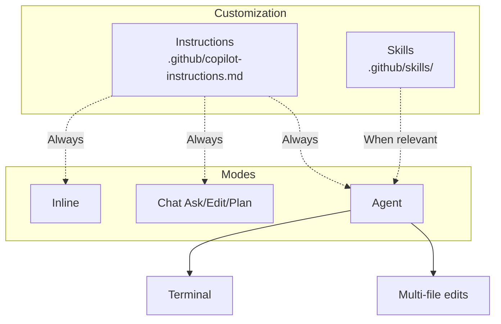

# Introduction — Developing in TypeScript with GitHub Copilot

Welcome to the **GitHub Copilot** course for **TypeScript**.

This course covers day-to-day GitHub Copilot usage: inline completions, Chat, repo customization and best practices for validating generated code.

## Audience and prerequisites

| Requirement | Detail |
| --------- | ------ |
| Development | Read and write code **TypeScript** |
| Git / GitHub | GitHub account, repo and commit basics |
| Editor | Visual Studio Code (recommended) |
| Copilot | Active subscription (Individual, Business or Enterprise) |

## Overall objectives

- Use inline completions with precise prompts.
- Master Copilot Chat (Ask, Edit, Plan, Agent).
- Customize the repo with Instructions and Skills.
- Configure path-specific rules, commits and assisted reviews.
- Apply a validation checklist on generated code.

## Structure — 6 modules

| Module | Topic | Duration |
| ------ | ----- | ----- |
| 1 | Introduction to GitHub Copilot | 2 h |
| 2 | Inline completions and context | 3 h |
| 3 | Chat and interaction modes | 3 h |
| 4 | Agent, Skills and Instructions | 4 h |
| 5 | Path-specific, commit and review | 3 h |
| 6 | Best practices and productivity | 2 h |

Chaque module comprend un **lesson**, des **exercises** et une **solution**.


**Next step :** [Module 1 — Introduction](/formations/en-github-copilot-typescript/module-01-introduction)

---

# Module 1 — Introduction to GitHub Copilot

This module covers GitHub Copilot basics for **TypeScript** development: what the tool is, which mode to use, and how to verify your VS Code setup.

**Estimated duration :** 2 h.

## Objectives

- Define GitHub Copilot and its role as a virtual pair programmer.
- Distinguish inline, Chat, Agent and CLI.
- Install and configure Copilot in VS Code.
- Review usage statistics.

---

> [!note] Definition — GitHub Copilot
> AI assistant in the editor. Analyzes **context** (files, comments, selection) and offers real-time **suggestions**.

## 1.1 What is GitHub Copilot?

GitHub Copilot is an AI-powered programming assistant developed by GitHub in collaboration with OpenAI. It works as a **virtual pair programmer** integrated directly into the code editor.

**How it works:**

- Copilot analyzes the context of code being written (open files, comments, variable names)
- It generates code suggestions in real time, directly in the editor
- The underlying model was trained on billions of lines of code from public GitHub repositories
- It is particularly effective in TypeScript thanks to the massive open source ecosystem (React, Node.js, NestJS, Deno, etc.)

**What Copilot is not:**

- It is not the TypeScript compiler (`tsc`) or ESLint
- It does not guarantee that generated code is correct or secure
- It does not replace understanding TypeScript and static typing

## 1.2 Copilot versions — from inline completion to Agent

GitHub Copilot offers several **autonomy levels**. This course focuses on **Agent** mode and its customization (**Instructions**, **Skills**), while keeping **inline completions** for day-to-day typing.

| Version              | Autonomy level     | Description                                    | Primary use                             |
| -------------------- | ------------------ | ---------------------------------------------- | --------------------------------------- |
| **Copilot (inline)** | Low                | Code suggestions directly in the editor        | Day-to-day completion, boilerplate      |
| **Copilot Chat**     | Medium             | Conversation (Ask, Edit, Plan)                 | Questions, explanations, refactoring    |
| **Mode Agent**       | High               | Plans, edits multiple files, executes          | Multi-file tasks, debug, migration      |
| **Copilot CLI**      | Élevé              | Agent en ligne de commande                     | Shell, tests, CI, scripts               |

**Copilot inline** remains the entry point: as soon as you type code, suggestions appear in grey (`Tab` to accept). See **Module 2**.

**Copilot Chat** covers Ask, Edit, Plan and Agent. See **Module 3**.

**Instructions, Skills and Agent mode**: see **Modules 4 and 5**.

**Copilot CLI** (`gh copilot`) brings agent logic outside the editor — useful to run tests (`npm test`), type-check (`tsc --noEmit`) or format code.

## 1.3 Installation and configuration

**Prerequisites:**

- A GitHub account with an active Copilot subscription (Individual, Business or Enterprise)
- Visual Studio Code installed
- Microsoft **TypeScript and JavaScript** extension (IntelliSense) + **ESLint** recommended

**Installation steps:**

1. Open VS Code
2. Go to Extensions (`Ctrl + Shift + X`)
3. Search for "GitHub Copilot" and install the extension
4. Also install "GitHub Copilot Chat"
5. Sign in to GitHub when VS Code prompts you
6. Check the Copilot icon in the status bar (bottom)

**Verifying it works:**
Create a `test.ts` file and start typing:

```typescript
// Function that prints Hello World
function greet(name: string): string {
```

If Copilot is working, a suggestion should appear in grey to complete the function.

## 1.4 Interface and usage statistics

To view Copilot usage statistics:

- Click the Copilot icon in the VS Code status bar
- Access the dashboard via GitHub: `Settings > Copilot > Usage`
- Available metrics: suggestion acceptance rate, lines of code generated, most used languages

In enterprise environments (Copilot Business/Enterprise), administrators have access to a detailed dashboard showing usage percentage by team and developer.

---

---

---

# Module 2 — Inline completions and context

In [module 1](/formations/en-github-copilot-typescript/module-01-introduction) we set up Copilot. **Inline completions** speed up TypeScript boilerplate (utility functions, tests). This module covers shortcuts, context and comment-prompts.

**Estimated duration :** 3 h.

## Objectives

- Master inline suggestion keyboard shortcuts.
- Explain the context window and its limits.
- Write comment-prompts (What / How / Constraints).
- Iterate: alternatives, partial accept, rephrase.

---

**Inline completions** are the most used mode day to day. Once **Instructions** are configured (Module 4), they produce suggestions aligned with project TypeScript standards.

> [!note] Definition — Inline completion
> Suggestion shown **in grey** while typing. Accept (`Tab`), reject (`Esc`) or browse alternatives.

## 2.1 Essential keyboard shortcuts

| Action                           | Shortcut (Windows/Linux)  | Shortcut (Mac)  |
| -------------------------------- | ------------------------- | --------------- |
| Accept suggestion                | `Tab`                     | `Tab`           |
| Reject suggestion                | `Esc`                     | `Esc`           |
| Next suggestion                  | `Alt + ]`                 | `Option + ]`    |
| Previous suggestion              | `Alt + [`                 | `Option + [`    |
| Accept next word                 | `Ctrl + →`                | `Cmd + →`       |
| Trigger manually                 | `Alt + \`                 | `Option + \`    |
| Open suggestions panel           | `Ctrl + Enter`            | `Ctrl + Enter`  |

The suggestions panel (`Ctrl + Enter`) opens a window with up to 10 alternative suggestions. Useful when the first suggestion is not suitable.

## 2.2 Triggering suggestions

### Start typing a function signature

```typescript
function calculateFactorial(n: number): number
```

Copilot will suggest the function body based on the explicit name and types.

### Write a descriptive comment

```typescript
/** Tri à bulles sur un tableau de nombres, retourne une copie triée */
function bubbleSort(arr: number[]): number[]
```

The comment guides Copilot on the expected algorithm.

### Create a data structure

```typescript
interface Employee {
  name: string;
  age: number;
  salary: number;
}
```

Copilot may suggest consistent functions (createEmployee, formatEmployee, etc.).

### Use explicit variable names

```typescript
const maxRetryCount = 3;
let errorMessage: string | null = null;
const inputStream = createReadStream("data.csv");
```

Clear variable names help Copilot understand the code intent.

## 2.3 Context matters

Copilot does not rely only on the current line. It analyzes a **broader context**:

**Files open in the editor:**
If you have `utils.types.ts` open with interfaces, Copilot will use them to generate consistent implementations in `utils.ts`.

**Imports influence suggestions:**

```typescript
import { Router } from "express";     // Copilot suggère des routes REST
import React, { useState } from "react"; // Copilot suggère des composants/hooks
import { z } from "zod";              // Copilot suggère des schémas de validation
```

**Surrounding code guides generation:**
Si les fonctions précédentes utilisent un style particulier (gestion d'erreurs, patterns async, immutabilité), Copilot va reproduire ce pattern.

```typescript
// Si votre code existant fait ceci :
const result = await fetch(url);
if (!result.ok) {
  throw new ApiError(result.status, await result.text());
}

// Copilot reproduira ce pattern de gestion d'erreur HTTP
```

## 2.4 The context window

The **context window** is the maximum amount of text — code, comments, chat history, project instructions — the model can process **in a single request**.

**Concrete definition:**

- Everything Copilot "sees" before responding occupies this window: open files, selection, chat messages, `@workspace`, Copilot instructions, etc.
- This limit is measured in **tokens** (text chunks), not lines of code.
- Beyond the limit, the oldest or lowest-priority content is **truncated**.

**Why it matters:**

| Consequence                       | Explanation |
| --------------------------------- | ----------- |
| **Context loss**                  | A large file + chat history can make Copilot "forget" the beginning. |
| **Less consistent suggestions**   | If your conventions no longer fit in the window, Copilot falls back to generic patterns. |
| **Incomplete Agent responses**    | On a large repo, the agent must target the right files. |
| **Prompt quality trade-off**      | Relevant context beats large context. |

**Best practices to optimize the window:**

- Keep only **relevant** files open (e.g. `utils.types.ts` + `utils.ts`, not the whole project).
- Ask **focused** questions in chat rather than pasting thousands of lines.
- Use `#file:src/services/parser.ts` for a specific file rather than `#workspace` when the question is local.
- Break large refactors into steps (module by module).
- Centralize project rules in **Instructions** (see Module 4).

## 2.5 The art of comment-prompts

In TypeScript, JSDoc comments and typed signatures guide Copilot.

**Vague comment → imprecise result:**

```typescript
// sort the array
```

**Precise comment → targeted result:**

```typescript
/**
 * Tri par insertion sur un tableau de nombres en ordre croissant.
 * Complexité O(n²) pire cas. Ne mute pas l'argument — retourne une copie.
 */
function insertionSort(arr: number[]): number[]
```

## 2.6 Core principles

**Be specific and precise:**

```typescript
// ❌ Vague
// lire un fichier

// ✅ Precise
/** Lit un fichier texte ligne par ligne. Retourne un tableau de lignes. Lance une erreur si le fichier est introuvable. */
async function readLines(filePath: string): Promise<string[]>
```

**Provide context:**

```typescript
// Cette fonction fait partie du service de cache Redis
// Récupère une clé avec TTL, retourne null si expirée ou absente
async function getCached<T>(key: string): Promise<T | null>
```

**Break down complex problems:**

```typescript
// Step 1 : Parser une ligne CSV en tokens
function parseCsvLine(line: string): string[];

// Step 2 : Convertir les tokens en Employee
function tokenToEmployee(tokens: string[]): Employee;

// Step 3 : Insérer dans le tableau avec immutabilité
function insertEmployee(employees: Employee[], emp: Employee): Employee[];
```

**Iterate on suggestions:**
If the first suggestion is not suitable, use `Alt + ]` to browse alternatives, or rephrase the comment.

## 2.7 Structure of a good prompt

An effective prompt follows the **What / How / Constraints** structure:

```typescript
/**
 * WHAT: Recherche un élément dans un tableau trié
 * HOW: Recherche dichotomique (binary search)
 * CONSTRAINTS:
 *   - Tableau trié croissant
 *   - Retourne l'index ou -1
 */
function binarySearch(arr: readonly number[], target: number): number
```

Another example:

```typescript
/**
 * WHAT: Clone profond d'un arbre binaire typé
 * HOW: Parcours récursif avec spread immuable
 * CONSTRAINTS:
 *   - Retourne null si la racine est null
 *   - Préserver le typage générique TreeNode<T>
 */
function deepCopyTree<T>(root: TreeNode<T> | null): TreeNode<T> | null
```

## 2.8 Iteration and refinement

**Partially accept a suggestion:**
Use `Ctrl + →` (accept word by word) when the start of the suggestion is good but the rest diverges.

**Modifier et relancer pour affiner :**

```typescript
// Premier essai — bubble sort basique
// Trier un tableau

// Deuxième essai — plus précis
/** Quicksort avec pivot médian, Lomuto, fallback insertion sort si length < 10 */
function quicksort(arr: number[]): number[]
```

**Combiner plusieurs suggestions :**
Accepter une suggestion pour le squelette, puis supprimer certaines parties et redemander avec un commentaire plus spécifique.

---

---

---

# Module 3 — Chat and interaction modes

After [inline completions](/formations/en-github-copilot-typescript/module-02-completions-inline), this module covers **Copilot Chat** to debug and plan TypeScript refactorings.

**Estimated duration :** 3 h.

## Objectives

- Use Ask, Edit, Plan and Agent modes.
- Select context (@workspace, #file, selection).
- Use slash commands (/explain, /fix, /tests).
- Understand semantic codebase indexing.

---

## 3.1 Chat modes — Ask, Edit, Plan, Agent

Copilot Chat offers several **modes** depending on the desired autonomy level. They share project **Instructions**; only **Agent** and partially **Ask** use **Skills** (see Module 4).

| Mode       | Autonomy  | Behavior                                          | TypeScript example                          |
| ---------- | --------- | ------------------------------------------------- | ------------------------------------------------- |
| **Ask**    | Low       | Answers, explains, does not modify files          | « Explain this useEffect hook and its dependencies »           |
| **Edit**   | Medium    | Modifies selected code or active file              | « Add strict typing on this any parameter »     |
| **Plan**   | Medium    | Produces a detailed plan before acting            | « Plan to migrate this CommonJS module to ESM »  |
| **Agent**  | High      | Plans, edits, executes, iterates                  | « Fix all ESLint errors under src/ »    |

**Ask** — understand code without modification:

- Select a block, ask a question: « Pourquoi cette Promise ne se résout jamais ? »
- Instructions apply (e.g. answer aligned with your JSDoc / TSDoc conventions)

**Edit** — localized changes:

- Select a function, request « /fix » or a targeted change
- Faster than Agent for a one-off change

**Plan** — large tasks:

- Copilot produces a numbered plan; you validate before switching to Agent

**Agent** — core of the agentic approach (see Module 4):

- Terminal access, multi-file, semantic index
- Automatically activates relevant **Skills**

## 3.2 Chat interface

Open the Chat panel: `Ctrl + Shift + I` (or `Cmd + Shift + I` on Mac).

**Useful TypeScript questions:**

- "Explique-moi ce composant React et son cycle de vie"
- "Pourquoi TypeScript infère `never` ici ?"
- "Comment implémenter un middleware Express typé ?"
- "Génère les tests Vitest pour cette fonction"
- "Optimise ce rendu React pour éviter les re-renders inutiles"

**Get detailed explanations:**
Select a complex code block then ask in chat:
"Explain this code step by step, especially async/await handling and types"

## 3.3 Slash commands

| Command    | Action                                              |
| ---------- | --------------------------------------------------- |
| `/explain` | Explains the selected code                          |
| `/fix`     | Suggests a fix for the selected code                |
| `/tests`   | Generates tests for the selected code               |
| `/doc`     | Generates documentation (JSDoc / TSDoc) |
| `/new`     | Creates a new file/project                          |
| `/clear`   | Clears chat history                                 |

**Example with `/doc` :**

```typescript
function addNode(list: LinkedList, data: unknown): number;
```

```typescript
/**
 * Adds a node at the head of the linked list.
 * @param list - Target list
 * @param data - Data to store
 * @returns Index of created node, or -1 on error
 */
function addNode(list: LinkedList, data: unknown): number;
```

## 3.4 Context selection

Highlight a code block, then open chat → Copilot understands the question is about that specific code.

## 3.5 Semantic codebase indexing

**Semantic indexing** lets Copilot **understand the meaning** of project code, not just match keywords.

**Principle:**

- The repository is analyzed as embeddings: functions, types, comments, relationships between files.
- A question like "Where is validation handled?" or `@workspace find duplicate handlers` relies on this index.
- Relevant results are injected into the context window.

| Approach                          | Limit |
| --------------------------------- | ------ |
| Open files + current line         | Only covers what you have on screen |
| Symbol name search                | Misses implementations under another name |
| **Semantic index**                | Finds code by **intent** (« validation Zod », « middleware auth », « gestion d'erreur API ») |

**Best practices:**

- Let indexing finish after a clone or large pull.
- Formulate queries with **concepts** (« React hook », « CSV parsing », « repository pattern »).
- Combine semantic index + `#file:src/services/parser.ts`.

## 3.6 Agent mode in practice

**Agent mode** is where **Skills** and **Instructions** configured in Module 4 are applied.

Copilot can:

- Run terminal commands (`npm test`, `tsc --noEmit`, `eslint`, `vitest`)
- Modify multiple files in sequence
- Iterate until the problem is solved or report a blocker

```
Agent mode: « Fix all TypeScript and ESLint errors under src/ »
→ Copilot activates the lint-and-typecheck skill (if present)
→ Applies Instructions (strict, no any)
→ Runs tsc and eslint, fixes files, re-runs tests
```

**Agent best practices:**

- State a **measurable goal** (« 0 tsc and eslint errors under src/ »)
- Let semantic indexing finish on large repositories
- Manually review the diff before commit

## 3.7 Cloud mode (overview)

Cloud mode runs Copilot tasks on GitHub infrastructure:

- Long-running background tasks
- No need to keep VS Code open
- Results via notification or PR
- Useful for large refactors or migrations

---

---

---

# Module 4 — Agent, Skills and Instructions

In [module 3](/formations/en-github-copilot-typescript/module-03-chat-modes) we explored Chat. This module covers **agent customization**: Instructions, Skills and Agent mode.

**Estimated duration :** 4 h.

## Objectives

- Write `.github/copilot-instructions.md` for a TypeScript project.
- Create a domain Skill (lint, tests, typecheck).
- Understand the Instructions → Skills → Agent flow.
- Test customization in Agent mode.

---

> [!note] Definition — Instructions
> **Permanent** repo rules injected on every interaction. Main file: `.github/copilot-instructions.md`.

> [!note] Definition — Instructions
> **Permanent** repo rules injected on every interaction. File: `.github/copilot-instructions.md`.

## 4.1 Overview

| Concept | Role | When active | Typical file |
| ------- | ---- | ----------- | -------------- |
| **Instructions** | Permanent project rules | **Always** (inline, chat, agent) | `.github/copilot-instructions.md` |
| **Skill** | Specialized workflow, loaded on demand | When the task matches the description | `.github/skills/<name>/SKILL.md` |
| **Agent** | Autonomous mode that plans and executes | On explicit request (Agent mode) | Chat panel or Copilot CLI |

**Instructions** define _how to code in this repo_. **Skills** teach _how to accomplish a recurring task_. **Agent** _orchestrates_ both.

| | Instructions | Skill |
| --- | --- | --- |
| **Content** | Short rules, project standards | Detailed workflow, scripts, references |
| **Activation** | Always | Only when the task is relevant |

## 4.2 Global Instructions — `.github/copilot-instructions.md`

File at the repository root (`.github/` folder). Copilot injects it in **every** interaction.

| File | Scope |
| ---- | ----- |
| `.github/copilot-instructions.md` | Global — entire repo |
| `.github/instructions/*.md` | Path-specific (`applyTo` in YAML header) |
| Personal instructions | GitHub → Settings → Copilot (all your projects) |

**Example:**

```markdown
# Instructions — TypeScript project

- `strict: true` ; avoid `any` on public API
- camelCase for variables/functions ; PascalCase for types and React components
- Prefer `async/await` over `.then()` chains
- JSDoc on public API (`@param`, `@returns`)
- Typed errors or `Result<T, E>` — no bare `throw` without context
- Before suggesting code: mentally run `tsc --noEmit`
```

**Best practices:**

- Keep it **short** (≤ 200 lines) — details belong in a Skill or path-specific instruction (module 5).
- Document _why_ a rule exists, not only _what_.
- Pedagogical rules: do not complete exercise stubs for students.

> Instructions stay **general**. For a detailed workflow, prefer a **Skill**.

## 4.3 Skills — `.github/skills/<name>/SKILL.md`

> [!note] Definition — Skill
> Folder with `SKILL.md` (`name`, `description` in YAML frontmatter). Copilot loads the skill **when the task matches** the YAML description.

**Structure:**

```
.github/skills/
└── lint-and-check/
    ├── SKILL.md
    ├── scripts/
    └── references/
```

**Example `SKILL.md`:**

```markdown
---
name: lint-and-check
description: Checks strict typing and ESLint. Use when the user mentions tsc, ESLint, type error, lint or strict mode.
---

## Workflow

1. Find project scripts (`npm run lint`, `npm run typecheck`)
2. Run `tsc --noEmit` then `eslint src/`
3. Fix types/imports per file
4. Re-run `vitest run` or `npm test`
```

| Action | Documentation |
| ------ | ------------- |
| Create a skill | [About agent skills](https://docs.github.com/en/copilot/concepts/agents/about-agent-skills) |
| Repository instructions | [Repository custom instructions](https://docs.github.com/en/copilot/customizing-copilot/adding-repository-custom-instructions-for-github-copilot) |

## 4.4 Agent mode in practice

**Agent mode** (Module 3) applies the Instructions and Skills configured above.

**Capabilities:**

- Run terminal commands (`npm test, tsc --noEmit, eslint`)
- Edit multiple files in sequence
- Iterate until a measurable goal is met or report a blocker

**Example:**

```
Agent mode: "Fix all TypeScript strict and ESLint errors under src/"
→ Runs tsc and eslint, fixes files, re-runs tests
```

**Best practices:**

- **Measurable** goal ("0 gcc warnings", "green tests")
- Review the diff before commit
- Let semantic indexing finish on large repos

## 4.5 Architecture diagram



## 4.6 Minimal setup

1. **Global Instructions** — `.github/copilot-instructions.md`
2. **Test instructions** — `.github/instructions/tests.md` with `applyTo: "**/*.spec.ts,**/*.test.ts"`
3. **One domain skill** — `.github/skills/lint-and-check/SKILL.md`
4. **Test in Agent** — `@workspace Fix TypeScript strict and ESLint errors under src/`

## 4.7 Reusable prompts (optional)

`.github/prompts/*.prompt.md` — templates for recurring requests (complement to Skills).

```markdown
<!-- .github/prompts/new-module.prompt.md -->
Create a new module with:
- `index.ts` exporting the public API
- Types/interfaces in `types.ts`
- Vitest tests in `__tests__/`
```

---

# Module 5 — Path-specific, commit and review

In [module 4](/formations/en-github-copilot-typescript/module-04-agent-skills) we set global Instructions. This module shows how to refine Copilot **per repo area**: API, tests and TypeScript source follow different rules.

**Estimated duration :** 3 h.

## Objectives

- Configure path-specific instructions (applyTo).
- Create advanced Skills with scripts.
- Generate commit messages with Copilot.
- Run an assisted code review.

---

The **Agent**, **Skill** and **Instruction** concepts are covered in **Module 4**.

## 5.1 Path-specific instructions

**Path-specific** instructions activate only when Copilot works on files matching a **glob**.

**Why use them:**

- React front-end (`src/components/`) does not follow the same rules as a Node API (`src/api/`)
- Tests (`*.spec.ts`) may allow mocks forbidden in production
- `.tsx` vs `.ts` files may require distinct conventions

**Recommended organization:**

```markdown
---
applyTo: "src/**/*.ts,src/**/*.tsx"
---

# Règles pour le code source TypeScript

- strict mode, pas de `any`
- Préférer les types inférés sauf API publique
- Composants React : PascalCase, props typées avec interface dédiée
```

```markdown
---
applyTo: "**/*.spec.ts,**/*.test.ts"
---

# Règles pour les tests

- Vitest ou Jest selon le projet existant
- Utiliser describe/it et les helpers du projet
- Mocker uniquement les dépendances externes, pas la logique testée
```

```markdown
---
applyTo: "exercices/**/*.ts"
---

# Context pédagogique — exercices étudiants

- Laisser les blocs TODO intacts
- Suggérer des indices en commentaire plutôt que des solutions complètes
- Respecter les signatures imposées par l'énoncé
```

**Priority order:**

1. Global Instructions
2. Path-specific instructions (matching glob)
3. Immediate context (file, selection, comment-prompt)

**Best practices:**

- Prefer **narrow** globs (`src/api/*.ts`) à `**/*`
- Document _why_ each rule exists
- Ensure a global rule does not override a local one

**Create advanced Skills:**

- Scripts dans `scripts/` (wrapper `npm run lint` avec options du projet)
- Doc lourde dans `references/` pour préserver la fenêtre de contexte
- Refine the YAML `description` — the **trigger** for selection

## 5.2 Reusable prompts (`.github/prompts/`)

```markdown
<!-- .github/prompts/new-module.prompt.md -->

Crée un nouveau module TypeScript avec :

- Un fichier `index.ts` exportant l'API publique
- Types/interfaces dans `types.ts`
- Tests Vitest dans `__tests__/`
- JSDoc sur chaque export public
```

## 5.3 Automated commits

- Click the Copilot icon in Source Control
- Copilot analyzes the diff and suggests a message (Conventional Commits if configured)

Exemple :

```
feat(parser): add CSV parsing with quoted field support

- Handle escaped quotes within fields
- Support multiline values enclosed in quotes
- Add error reporting with line numbers
```

## 5.4 Code review on pending commits

- Source Control → "Review Changes" with Copilot
- Particularly useful in TypeScript to detect:

- Uses of `any` or unsafe type assertions
- Promises non gérées (floating promises)
- Node memory leaks (listeners, timers)
- XSS via `dangerouslySetInnerHTML` or template injection

## 5.5 Fine-tuning and customization

- **Instructions** (Module 4) influence all suggestions
- **Skills** standardize recurring workflows
- Copilot learns patterns from existing code in the repository

---

---

---

# Module 6 — Best practices and productivity

In [module 5](/formations/en-github-copilot-typescript/module-05-path-specific-review) we refined governance. This closing module covers **when** to trust Copilot and **how** to validate generated TypeScript code.

**Estimated duration :** 2 h.

## Objectives

- Apply a validation checklist on generated code.
- Identify suitable (and unsuitable) Copilot use cases.
- Adopt a sustainable productivity workflow.
- Formalize team best practices.

---

## 6.1 Validating generated code

TypeScript code generated by Copilot requires particular attention:

**Always verify:**

- Typing (no hidden `any`, correct generics)
- Async handling (await, errors, race conditions)
- null/undefined (`strictNullChecks`)
- React dependencies (useEffect/useMemo deps array)
- Security (input sanitization, hardcoded secrets)

**Validation tools:**

```bash
# Type checking
npx tsc --noEmit

# Lint
npx eslint src/

# Tests
npm test
# ou
npx vitest run
```

## 6.2 When to use Copilot

**Repetitive or boilerplate code:**

```typescript
// Copilot excels at generating similar CRUD functions
function createEmployee(data: CreateEmployeeDto): Employee;
function updateEmployee(id: string, data: UpdateEmployeeDto): Employee;
function deleteEmployee(id: string): void;
function getEmployeeById(id: string): Promise<Employee | null>;
```

**Classic algorithms, tests, API exploration:**
Copilot knows standard implementations and boilerplate (React, Express, Zod, Prisma).

**Unit tests:**

```typescript
// Ask: "Generate Vitest tests for binarySearch"
describe("binarySearch", () => {
  it("finds existing element", () => {
    expect(binarySearch([1, 3, 5, 7, 9], 7)).toBe(3);
  });
  it("returns -1 when not found", () => {
    expect(binarySearch([1, 3, 5, 7, 9], 4)).toBe(-1);
  });
});
```

## 6.3 When to be cautious

**Security-critical code:** always review and test thoroughly.

**Complex business logic:** Copilot may produce syntactically correct but semantically wrong code.

**Specific constraints:** SSR, edge runtime, optimized bundles — Copilot may not know deployment constraints.

**Critical performance:** Copilot generates working but rarely optimal code. For critical loops or heavy React rendering, human expertise remains essential.

## 6.4 Optimal productivity

- Read and understand each suggestion before accepting it
- Copilot speeds up writing; it does not replace thinking
- Watch suggestions to discover idioms (`structuredClone`, `Array.at()`, utility types like `Partial`, `Pick`)

**Adapt your workflow progressively:**

1. **Inline completions** — boilerplate (Module 2)
2. **Chat Ask/Edit** — debugging and documentation (Module 3)
3. **Instructions** — `.github/copilot-instructions.md` (Module 4)
4. **Skills** — recurring workflow (Module 5)
5. **Agent mode** — multi-file tasks with diff review

---
